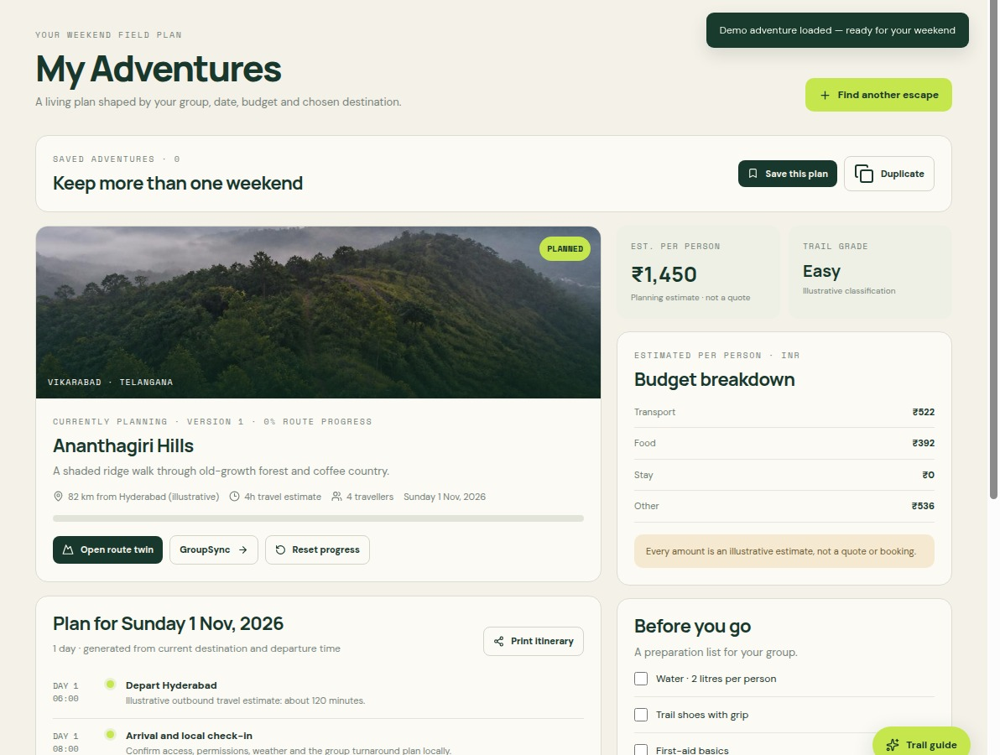
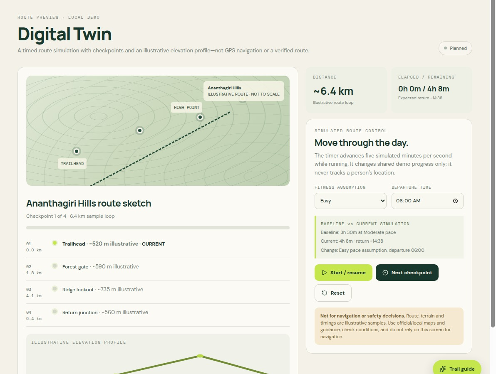

# TrekVerse AI

**Your intelligent weekend adventure OS.**

Plan nearby. Align the group. Adapt when plans change.

TrekVerse AI is a local-first planning prototype for groups with different budgets, fitness levels and activity preferences. Explainable destination matching, a dated itinerary, a route simulation and scenario-based replanning share one connected trip.

> This is a planning MVP, not navigation, live weather, emergency assistance or safety clearance. Destination details, costs and terrain are illustrative unless explicitly sourced. See [limitations](docs/LIMITATIONS.md).

## What works

| Module | App label | Capability |
| --- | --- | --- |
| EscapeOS | Discover / My Adventures | Origin-matched ideas, constraints, comparison, itinerary and locally saved trips |
| GroupSync | GroupSync | Editable members, compatibility explanations and separate votes |
| TrekTwin | Digital Twin | Timed route simulation, checkpoints, pace and progress |
| TrailIQ | Trail Intelligence | Preparation checklist and heuristic readiness explanations |
| PlanB | PlanB | Preview, reject, apply and restore scenario-based revisions |
| QuestTrail | QuestTrail | One-time XP rewards and achievement history |
| TrekForGood | Impact | Dated, self-reported contributions |

The offline catalog covers Hyderabad, Bengaluru, Mumbai, Pune, Delhi, Chennai, Kuala Lumpur, George Town/Penang, Johor Bahru and Singapore. Country names require an actual starting city; unsupported cities do not fall back to Hyderabad.

Optional online city search (Nominatim) and nearby map discovery (Overpass/OpenStreetMap) extend research beyond those catalogs. Users explicitly choose a city and run the search. Nearby points within 25 km are research candidates only: straight-line distance, unknown route/cost/grade/access, and no generated itinerary. Results include attribution and a 24-hour cache.

Budgets support INR, MYR and SGD. Conversion uses a disclosed **2025-01-02 reference**, not current exchange rates. Legacy records without a currency remain INR.

## Run locally

Use Node.js 24 and pnpm. Run commands from the repository root:

```sh
pnpm install --frozen-lockfile
PORT=5000 BASE_PATH=/ pnpm --filter @workspace/trekverse-ai run dev
```

In Replit, use the existing `artifacts/trekverse-ai: web` workflow; do not launch a duplicate server. It supplies the port and base path.

```sh
pnpm --filter @workspace/trekverse-ai run typecheck
PORT=5000 BASE_PATH=/ pnpm --filter @workspace/trekverse-ai run build
```

The web MVP requires no account, API key or database. The repository also contains an Express API scaffold, shared packages and a project presentation; they are not required by the current local planning engine. Browser storage is not a backup.

## Preview and presentation

- Application: the workspace's web Preview at `/`.
- Updated nine-slide project deck: `/trekverse-deck/`.
- No published URL is recorded here; the workspace preview is a development address.





These presentation captures are illustrative UI snapshots and may predate subsequent controls such as currency selection.

## Technology and repository

React, TypeScript, Vite, Lucide icons and CSS/Tailwind in a pnpm workspace. Planning and currency calculations are deterministic TypeScript functions; the assistant is rule-based, not an LLM integration.

```text
artifacts/trekverse-ai/             Web application and logic tests
artifacts/api-server/              Express API scaffold
artifacts/trekverse-project-deck/   Project slides
artifacts/mockup-sandbox/          Isolated visual previews
lib/                              Shared workspace packages
docs/                             Product and engineering documentation
```

## Documentation

Start with [feature status](docs/FEATURE_STATUS.md), [requirements](docs/PRD.md), [architecture](docs/ARCHITECTURE.md) and the [demo script](docs/DEMO.md).

- Development: [agent instructions](AGENTS.md), [contributing](CONTRIBUTING.md), [testing](docs/TESTING.md), [data models](docs/DATA_MODELS.md)
- Product: [user flows](docs/USER_FLOWS.md), [roadmap](docs/ROADMAP.md), [limitations](docs/LIMITATIONS.md)
- Design and decisions: [design system](docs/DESIGN_SYSTEM.md), [AI strategy](docs/AI_STRATEGY.md), [decisions](docs/DECISIONS.md)
- History: [changelog](CHANGELOG.md)

Documentation baseline: **2026-10-31**. Current typecheck passes. The direct Node test runner is blocked by module resolution; see [testing](docs/TESTING.md) before claiming a green suite.
