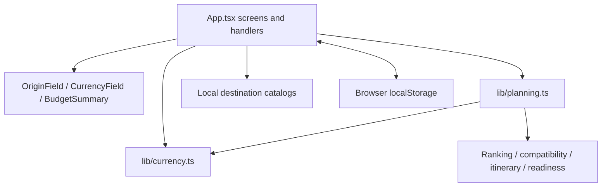
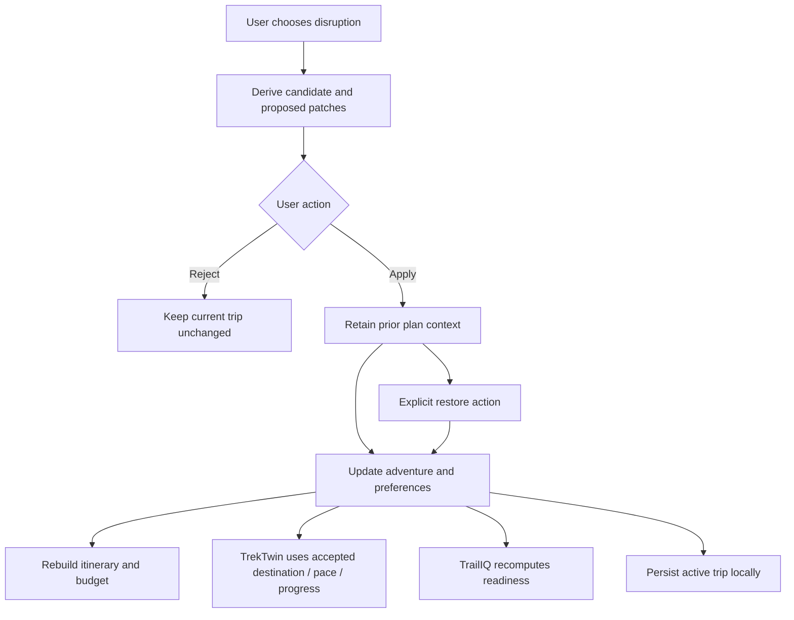

# Architecture

## System boundary

The working planning MVP is a React/Vite browser application. `App.tsx` coordinates screens and trip state using React hooks. A `Screen` value selects the visible view; the primary app does not currently have a URL route per tab. Reload therefore must not be described as restoring the previously open screen.

The Express API artifact and shared API/database workspace packages are scaffolding, not the current persistence or calculation backend. The slides and mockup sandbox are separate artifacts.

## Module dependencies

- The original Hyderabad catalog resides in `App.tsx`; regional additions are in `lib/regional-destinations.ts`.
- `planning.ts` contains origin resolution, hard constraints, fit factors, compatibility, itinerary generation, budget breakdown, readiness and sample profiles.
- `currency.ts` converts using a frozen dated reference and treats missing units as INR.
- `discovery.ts`, `OriginField` and `NearbyDiscovery` provide explicit-request Nominatim city search and Overpass nearby map research, with provenance, request/error handling and a 24-hour browser cache. Discovered points remain separate from ranked/plannable catalog destinations.
- `index.css` contains the theme, layout and responsive rules.

## Shared state and persistence

Preferences represent the current discovery brief. The active adventure has its own destination, stored preference context, members, progress, checklist, tasks, votes and revision metadata. Saved adventures are a separate collection; bookmarks are destination IDs, not full trip snapshots.

React effects persist preferences, the active adventure, bookmarks and saved adventures to browser storage. Load helpers normalize older records. There is no server synchronization, transactional persistence layer or cloud backup.

A changed search origin selects a new candidate pool, not a relabeled active trip. Trip screens use the trip's own origin context. The same distinction applies to stored currency: absence means INR regardless of location.

Optional online discovery sends the typed city or selected coordinates to public map providers, not the trip roster or budgets. Its separate cache uses the `tv-discovery-v1:` key prefix. Online candidates have unknown routing, grade, access and cost; they are not passed into itinerary generation.

## PlanB propagation

This is handler-driven state propagation, not a background multi-agent workflow. Do not assume every active-trip revision is automatically written into every previously saved copy; inspect save/update handlers when changing these semantics.

## Constraints

Runtime code currently concentrates many screens in one large component file. Extracting focused components is a maintenance opportunity, not a reason to rewrite working behavior. New online integrations should preserve explicit offline/error states and must not replace local storage without approved scope.
